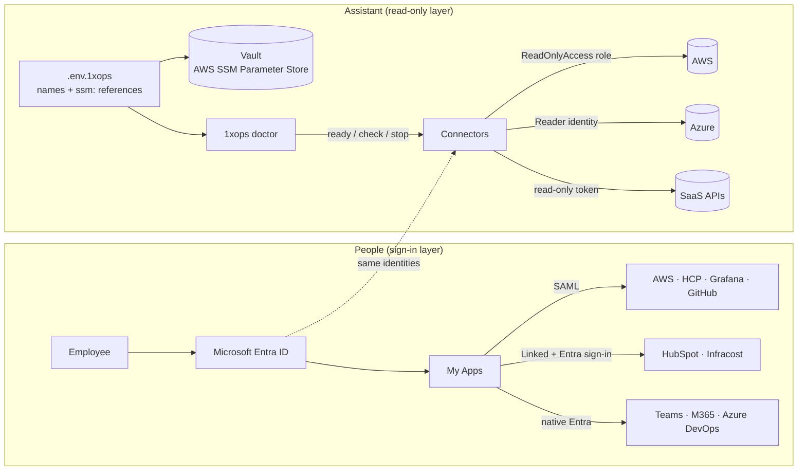
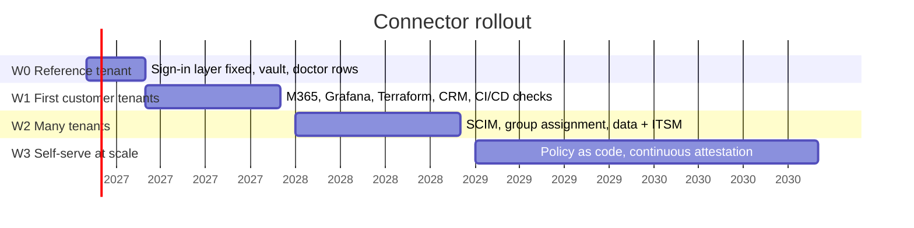

# Connectors

How 1xops connects one tenant, then hundreds, to the tools its people and its assistant use. Every value is a
variable. No account ID, tenant ID, e-mail address or token is ever written in this repository.

> [!IMPORTANT]
> **Two layers, one identity provider.**
> **People** sign in once, through the tenant's identity provider (Microsoft Entra ID), and reach every tool from
> My Apps.
> **The assistant** uses only **read-only identities** that the tenant creates for it, and `1xops doctor` checks
> each one before the first cloud call.
> The identity is the boundary. The rules only ask.

---

## Contents

1. [How it fits together](#how-it-fits-together)
2. [Configuration: variables, never values](#configuration-variables-never-values)
3. [As-is: the reference tenant](#as-is-the-reference-tenant)
4. [To-be: connector catalogue](#to-be-connector-catalogue)
5. [Rollout 2026–2030](#rollout-20262030)
6. [Plan and licence limits](#plan-and-licence-limits)
7. [Add a connector](#add-a-connector)

---

## How it fits together



| Layer | Who | Proven by | Never |
|---|---|---|---|
| Sign-in | People | A tile launch from a **clean session** (signed out of the app first) | A pass from a session that was already signed in |
| Read-only | The assistant | `1xops doctor`: every row `ready` or `check`, none `can change things` | The owner's own login, a write role, a token that can change things |

---

## Configuration: variables, never values

A tenant is a folder with one `.env.1xops`. That file is tracked in git and holds **names and references only**.
Values live in a vault and are read at run time with the tenant's own read-only identity.

```dotenv
# tenants/<tenant>/.env.1xops : tracked, no values
ONEXOPS_CONNECTORS=aws,azure,itsm
AWS_CONFIG_FILE=~/.aws/tenants/<tenant>/config        # AWS's own local file, outside git
AWS_BILLING_PROFILE=<tenant>-billing-ReadOnly
AWS_OPERATIONS_PROFILE=<tenant>-<account>-ReadOnly
AWS_OPERATIONS_ACCOUNT=ssm:/1xops/tenants/<tenant>/AWS_OPERATIONS_ACCOUNT
AZURE_CONFIG_DIR=~/.azure-<tenant>-reader               # a Reader identity, never the owner's login
AZURE_DEVOPS_ORG=ssm:/1xops/tenants/<tenant>/AZURE_DEVOPS_ORG
GRAFANA_URL=ssm:/1xops/tenants/<tenant>/GRAFANA_URL
```

| Kind | Where it lives | Example | Read with |
|---|---|---|---|
| Names, profiles, paths | `.env.1xops` (git) | `AWS_BILLING_PROFILE` | — |
| IDs (account, subscription, org) | Vault, `String` | `/1xops/tenants/<tenant>/AWS_OPERATIONS_ACCOUNT` | the tenant's ReadOnly role |
| Tokens and keys | Vault, `SecureString` | `/1xops/tenants/<tenant>/GITHUB_TOKEN` | the tenant's ReadOnly role + decrypt |
| SSO start URL, region | AWS's own config file | `~/.aws/tenants/<tenant>/config` | the AWS CLI |

<details>
<summary><b>Why AWS SSM Parameter Store</b></summary>

- Standard parameters cost nothing, and the service is already in every AWS tenant: one less system to run.
- Access follows the same IAM role the assistant already uses, so there is no second credential to protect.
- Tenants without AWS use the same `ssm:`-style reference against Azure Key Vault (`kv:`); the shape of `.env.1xops` does not change.
- Rejected: secrets encrypted inside git (one leaked key opens every past commit), and a self-hosted vault (one more service to patch for a small team).

</details>

> [!WARNING]
> Values are written to the vault by a person with a write-capable profile, never by the assistant. `1xops` prints
> a value from the vault only masked (`****1234`) and never writes it to disk.

---

## As-is: the reference tenant

The `os` tenant, checked on **19 Nov 2026** in a real browser and a real terminal.

> [!NOTE]
> **Two kinds of test, never mixed up.**
> **Clean**: signed out of the app first, then launched from My Apps. The sign-in really ran.
> **Warm**: launched with an app session already open. This proves only the tile and the landing page, not the
> sign-in, because a live session skips SAML entirely.
> A row is ✅ only after a clean test.
>
> **Status:** ✅ Entra sign-in proven · 🔑 works with the app's own sign-in (Entra SSO is a paid upgrade, not a fault) · 🛠️ set up, being finished · ⏳ waiting for a clean test · 🔜 planned

### Sign-in layer (Entra ID → My Apps)

| Tool | Sign-in | Test | Status | Evidence | Next |
|---|---|:-:|:-:|---|---|
| AWS IAM Identity Center | SAML | clean | ✅ | signed out of the portal → fresh Entra `Success` in the sign-in log → 3 accounts, each with `ReadOnlyAccess` | one read-only CLI profile per account |
| Grafana Cloud | SAML (SP-initiated) | clean | ✅ | signed out → tile → login page → "Sign in with SAML" → Entra → home | the free stack sleeps: CAPTCHA on first visit |
| Atlassian · Jira · Confluence | Entra sign-in (OIDC) behind a Linked tile | clean | ✅ | logged out of all accounts → tile → login → "Continue with Microsoft" → Atlassian Home | Atlassian Guard SAML is a paid upgrade |
| HubSpot | Entra sign-in (OIDC) behind a Linked tile | clean | ✅ | signed out → launcher → HubSpot login → "Sign in with Microsoft" → portal home | the new tile is not yet listed in My Apps (the launcher works); HubSpot's own 2FA skipped |
| M365 MCP app registrations | API only | — | ✅ | hidden from My Apps; checked gone from the page | review Graph permissions: read-only, consent recorded |
| Infracost | Linked tile | — | ✅ honest | one tile left; the plan has no SSO setting | GitHub/Google sign-in until Enterprise |
| GitHub (org) | own GitHub sign-in (tile is a bookmark) | clean | 🔑 | signed out → tile opens the **public** org page with "Sign in"; `/orgs/<org>/sso` is 404, so the org has no SAML | GitHub Enterprise Cloud for SAML; until then, GitHub sign-in |
| Slack | own Slack sign-in (Linked tile) | clean | 🔑 | signed out → tile → Slack sign-in offers Google, Apple or an e-mail code only | Slack SAML needs a paid plan |
| Azure DevOps | Entra native | warm | ⏳ | lands in the org | clean test needs a full Entra sign-out and the owner's sign-in |
| Microsoft Teams | Entra native | warm | ⏳ | lands signed in | clean test needs a full Entra sign-out and the owner's sign-in |
| Salesforce (developer org) | SAML, Federation ID | clean | 🛠️ | Entra logs **Success**, Salesforce shows "Single Sign-On Error" | owner signs in with the password; set and verify the Federation ID; Assertion Validator; retest |
| HashiCorp Cloud Platform | SAML (SP-initiated) | clean | 🛠️ | URL migration done before the 31 Jan 2027 deadline; Entra logs **Success**, HCP rejects the owner e-mail (an IBMid owner) | separate Entra test user, or a HashiCorp support case; IBMid stays as break-glass |
| Google Workspace | SAML | — | 🔜 | requested | is there an existing Workspace for the domain, or a new trial? |
| Assistant platform | SAML | — | 🔜 | requested | depends on the plan offering SSO |

**Break-glass, one per app, never removed:** a password or IBMid login that does not depend on Entra, kept for
each app whose SSO can lock people out (HCP: IBMid; Salesforce: the password form stays on).

### Read-only layer (`1xops doctor`, version 0.3.2)

Re-run on 19 Nov 2026, 02:40 UTC: **Score 1 of 6 connectors ready**.

| Connector | Status | Fix |
|---|:-:|---|
| AWS billing (`AWS_BILLING_PROFILE`) | ✅ ready | read-only, signed in until 03:10 UTC |
| AWS operations (`AWS_OPERATIONS_PROFILE`) | ❌ wrong account | the proof folder expects a different account on purpose; one ReadOnly profile per account, IDs from the vault |
| Google Calendar · Gmail | ❌ not connected | connect them, or list them in `ONEXOPS_IGNORE` |
| GitHub | ⚠️ check | the token can change things: use a fine-grained read-only token |
| Azure DevOps | ❌ broken | `AZURE_DEVOPS_ORG` from the vault |
| Azure | ⚠️ not checked | a Reader identity in its own `AZURE_CONFIG_DIR` |
| Atlassian · Slack · Notion | ➖ in host | sign in inside the assistant (`/mcp`) |
| Grafana · HCP Terraform · Infracost · HubSpot · M365 | ❌ none | to-be, see below |

---

## To-be: connector catalogue

Merged from every plugin's `CONNECTORS.md`. A plugin names a category (`~~chat`). The tenant decides which tool
fills it, and 1xops checks that tool's identity.

<details>
<summary><b>Sources and sync check</b> (13 plugin files)</summary>

[customer-support](plugins/customer-support/CONNECTORS.md) ·
[data](plugins/data/CONNECTORS.md) ·
[design](plugins/design/CONNECTORS.md) ·
[engineering](plugins/engineering/CONNECTORS.md) ·
[enterprise-search](plugins/enterprise-search/CONNECTORS.md) ·
[finance](plugins/finance/CONNECTORS.md) ·
[human-resources](plugins/human-resources/CONNECTORS.md) ·
[legal](plugins/legal/CONNECTORS.md) ·
[marketing](plugins/marketing/CONNECTORS.md) ·
[operations](plugins/operations/CONNECTORS.md) ·
[product-management](plugins/product-management/CONNECTORS.md) ·
[productivity](plugins/productivity/CONNECTORS.md) ·
[sales](plugins/sales/CONNECTORS.md)

Every placeholder a plugin uses must appear in the table below. This lists any that are missing (no output means
the catalogue is in sync):

```sh
grep -h '^|' plugins/*/CONNECTORS.md | grep -o '`~~[^`]*`' | sort -u | while read -r p; do grep -qF "$p" CONNECTORS.md || echo "missing: $p"; done
```

</details>

**Legend:**
- ✅ checked by `1xops doctor` today
- 🟡 in host: it signs in inside the assistant
- 🔜 planned, with the wave in brackets
- ➖ no supported server yet

| Category | Placeholder | Reference choice | Alternatives | People sign-in | Assistant identity | 1xops |
|---|---|---|---|---|---|:-:|
| Cloud: AWS | — | AWS | — | Entra → Identity Center (SAML) | ReadOnlyAccess role per account | ✅ |
| Cloud: Azure | — | Azure | — | Entra native | Reader in its own config folder | ✅ |
| Source control | `~~source control` | GitHub | GitLab, Bitbucket | GitHub sign-in today; SAML with Enterprise Cloud | fine-grained read-only token | ✅ |
| CI/CD | `~~CI/CD` | GitHub Actions | Azure Pipelines, CircleCI, Jenkins | as source control | same token, `actions:read` | 🔜 (W1) |
| Project tracker | `~~project tracker` | Jira, Azure DevOps | Linear, Asana, monday.com | Entra sign-in (Jira: OIDC; Azure DevOps: native) | read-only scope | 🟡 / ✅ |
| Knowledge base | `~~knowledge base` | Confluence | Notion, Guru, Coda | Entra sign-in (OIDC) | read-only scope | 🟡 |
| Chat | `~~chat` | Slack, Microsoft Teams | Discord | Slack: Google/e-mail today, SAML on a paid plan; Teams: Entra native | read-only scope | 🟡 |
| Email · calendar · office suite | `~~email` `~~calendar` `~~office suite` | Microsoft 365 | Google Workspace | Entra native | Entra app, read-only Graph scopes | 🔜 (W1) |
| Cloud storage | `~~cloud storage` | SharePoint / OneDrive | Box, Dropbox, Google Drive | Entra native | read-only Graph scopes | 🔜 (W1) |
| Monitoring | `~~monitoring` | Grafana | Datadog, New Relic, Splunk | SAML | viewer service-account token, no write | 🔜 (W1) |
| Infrastructure as code | — | HCP Terraform | — | SAML | read-only team token, operations off | 🔜 (W1) |
| Cloud cost | — | AWS Cost Explorer, Infracost | Azure Cost Management | Entra / Linked | billing read-only role, read-only API key | ✅ / 🔜 (W1) |
| ITSM | `~~ITSM` | Jira Service Management | ServiceNow, Zendesk, Freshservice | Entra | read-only scope | 🟡 |
| CRM | `~~CRM` | HubSpot, Salesforce | Pipedrive, Close, Attio | Entra sign-in (HubSpot) · SAML (Salesforce) | read-only private-app token · read-only integration user | 🔜 (W1) |
| Office suite (Google) | `~~office suite` `~~email` `~~calendar` | Google Workspace | — | SAML | read-only domain-wide scopes, admin-approved | 🔜 (W1) |
| Marketing automation | `~~marketing automation` | HubSpot | Marketo, Mailchimp | as CRM | as CRM | 🔜 (W2) |
| Support platform | `~~support platform` | HubSpot Service Hub | Intercom, Zendesk | as CRM | read-only | 🔜 (W2) |
| Data warehouse | `~~data warehouse` | Snowflake, Databricks | BigQuery, Redshift | SAML | read-only role | 🔜 (W2) |
| Analytics / BI | `~~analytics` | Power BI | Tableau, Looker | Entra native | viewer | ➖ |
| Incident management | `~~incident management` | — | PagerDuty, Opsgenie | SAML | read-only key | 🔜 (W2) |
| Design | `~~design` `~~design tool` | — | Figma, Canva, Sketch | SAML | read-only token | 🔜 (W3) |
| Product analytics | `~~product analytics` | — | Amplitude, Mixpanel | SAML | read-only key | 🔜 (W3) |
| User feedback | `~~user feedback` | — | Intercom, Productboard, Canny | SAML | read-only key | 🔜 (W3) |
| Notebook | `~~notebook` | — | Hex, Jupyter, Deepnote | SAML | read-only workspace token | 🔜 (W3) |
| Competitive intelligence | `~~competitive intelligence` | — | Similarweb, Crayon, Klue | SAML | read-only key | 🔜 (W3) |
| SEO | `~~SEO` | — | Ahrefs, Semrush, Moz | Linked | read-only API key | 🔜 (W3) |
| Email marketing | `~~email marketing` | HubSpot | Klaviyo, Mailchimp, Brevo | as CRM | read-only | 🔜 (W2) |
| Marketing analytics | `~~marketing analytics` | — | Supermetrics, Google Analytics | SAML | read-only | 🔜 (W3) |
| Sales engagement | `~~sales engagement` | — | Outreach, Apollo, Salesloft | SAML | read-only | 🔜 (W3) |
| Data enrichment | `~~data enrichment` | — | Clay, ZoomInfo, Apollo | Linked | read-only API key | 🔜 (W3) |
| Conversation intelligence | `~~conversation intelligence` | — | Gong, Fireflies, Zoom | SAML | read-only | 🔜 (W3) |
| Compensation data | `~~compensation data` | — | Pave, Radford | SAML | read-only | ➖ |
| Meeting transcription | `~~meeting transcription` | — | Fireflies, Gong | SAML | read-only | 🔜 (W3) |
| HRIS · ATS | `~~HRIS` `~~ATS` | — | Workday, BambooHR, Greenhouse | SAML | read-only report user | 🔜 (W3) |
| ERP · procurement | `~~erp` `~~procurement` | — | NetSuite, SAP, Coupa | SAML | read-only | ➖ |
| E-signature · CLM | `~~e-signature` `~~CLM` | — | DocuSign, Ironclad | SAML | read-only | 🔜 (W3) |

---

## Rollout 2026–2030



| Wave | Scope | Exit gate (measurable) |
|---|---|---|
| **W0** · Nov 2026 – Mar 2027 | Reference tenant: every My Apps tile honest, vault in use, IDs out of git | 100% of tiles proven from a clean session; `doctor` shows 0 `can change things`; `git grep` finds 0 IDs |
| **W1** · 2027 | First customer tenants; M365, Grafana, HCP Terraform, CRM and CI/CD rows | New tenant onboarded in ≤ 1 day; ≥ 90% of its connectors `ready` or `check` on day one |
| **W2** · 2028 | 10+ tenants; SCIM provisioning and group assignment (Entra ID P1); data warehouse and ITSM | Joiner/mover/leaver reaches every app in ≤ 1 hour; `1xops tenants` shows every tenant on one screen |
| **W3** · 2029–2030 | Self-serve onboarding, connector policy as code, continuous attestation | 100+ tenants; quarterly access review generated, not hand-made; mean time to fix a broken connector < 1 business day |

---

## Plan and licence limits

These limits are what the vendors offer today. They are not workarounds. Each one is stated in the product and in
the tenant's own record.

| Vendor | Limit found | Effect | Path |
|---|---|---|---|
| Microsoft Entra ID (Free) | No group assignment for apps | Users are assigned one by one | Entra ID P1 at W2 |
| HubSpot (free) | SAML SSO needs Professional | Entra sign-in (OIDC) and a Linked tile | Professional when SSO enforcement is required |
| GitHub (Free/Team org) | SAML SSO needs Enterprise Cloud | The tile is a bookmark; GitHub sign-in stays separate | Enterprise Cloud when SSO enforcement is required |
| Slack (free) | SAML SSO needs a paid plan; no Microsoft sign-in option | Google, Apple or an e-mail code only | Business+ when SSO enforcement is required |
| Atlassian (free) | SAML needs Atlassian Guard | "Continue with Microsoft" (OIDC) works today | Guard when SSO enforcement is required |
| Infracost | SSO is an Enterprise feature | Linked tile; GitHub/Google sign-in | Enterprise when SSO enforcement is required |
| Grafana Cloud (free) | The stack sleeps when idle | A CAPTCHA wakes it; the first check can time out | Paid stack, or `doctor` reports `check: wakes on first visit` |
| HashiCorp Cloud Platform | Old SSO URL retires 31 Jan 2027; password sign-in ends the same day | Migration required; break-glass via IBMid | Done for the reference tenant |
| Microsoft 365 | Some MCP servers need licences the tenant may not hold | Server answers but every call fails | Check licences before you enable a server |
| Microsoft Entra ID | A Linked app just created has no assignable role for a few minutes ("Default Access" fails) | The first assignment fails | Retry after propagation; the role then shows as `User` |
| Salesforce | Metadata is fetched only from an allowed Remote Site | "Specify a public URL from Remote Site Settings" | Add the identity provider's sign-in host as a Remote Site first |
| HubSpot | Its own 2FA prompt appears after Entra sign-in | One extra screen | Entra MFA is the control; HubSpot 2FA is optional |

---

## Add a connector

1. **Pick the category** from the catalogue. The plugin stays unchanged, and the tenant chooses the tool.
2. **People:** add the vendor's gallery app in Entra. Use SAML when the plan allows it, and set the Sign-on URL so the tile starts the sign-in at the vendor (SP-initiated).
3. **Assistant:** create the vendor's **read-only** identity. Put its token in the vault (`SecureString`) and only its name in `.env.1xops`.
4. **Check:** `1xops doctor` must show the row `ready` or `check` before first use. A row that says `can change things` means stop.
5. **Prove it from clean:** sign out of the app, launch it from My Apps, and look at the result. A pass from a session that was already open does not count. If it fails, read the identity provider's sign-in log first: `Success` there means the app is rejecting the sign-in (user mapping, Federation ID, entity ID), not the identity provider. Then sign out of the terminal session, run `doctor` again, and look again.
6. **Record:** update the tenant's row in its own private record, never here.
